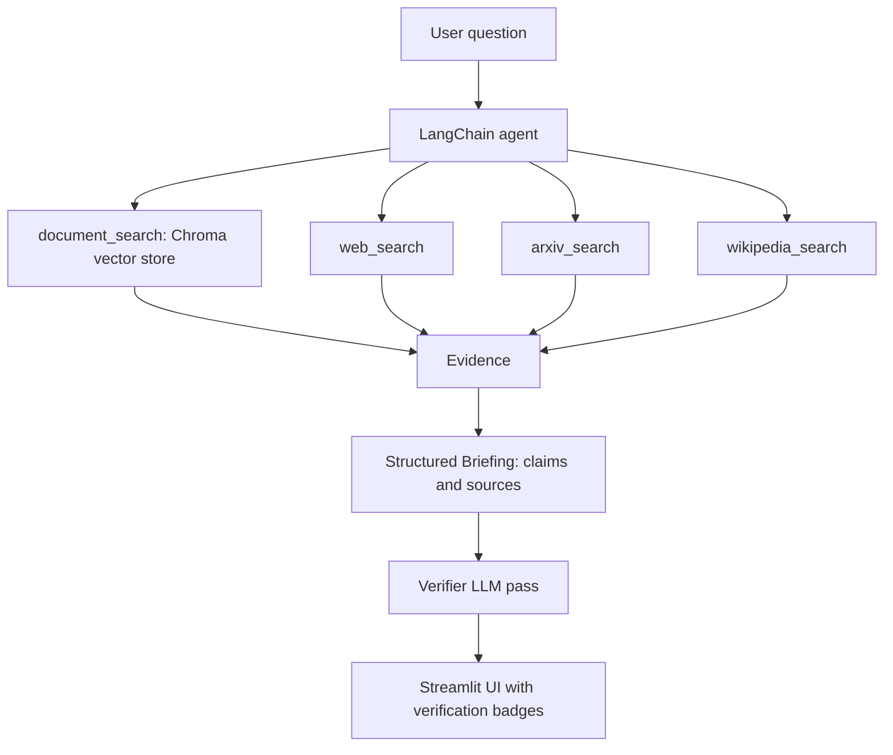

# CiteWise: Agentic RAG Research Assistant

An AI research assistant that answers questions from **your own PDFs and live sources**, attaches a citation to every claim, and then **verifies each claim against its source**.


## What it does

- **Routes automatically:** an agent searches your uploaded documents first, then falls back to Wikipedia, arXiv, or the web.
- **Structured answers:** every answer is a validated object (summary, claims, sources, confidence), not loose text.
- **Self-checking:** a second LLM pass judges each claim as supported, partial, or unsupported, using only the retrieved evidence.

## Architecture



## Tech stack

Python 3.10, LangChain 1.x, Google Gemini (chat and embeddings), Chroma, Pydantic, Streamlit.

## Evaluation

All tests run on one 19-page paper (the original RAG paper). Treat numbers as directional.

**Retrieval (12 questions per set, k=5)**

| Test | Method | Hit@1 | Hit@5 | MRR |
|---|---|---|---|---|
| Page match | Vector only | 92% | 100% | 0.958 |
| Chunk match (harder) | Vector only | 75% | 100% | 0.875 |
| Chunk match (harder) | Hybrid (BM25 + vector) | [from your eval_compare output] | [..] | [..] |

Hybrid search did not improve results on this document, so it is not used. A reranker was not built because the top 4 chunks passed to the LLM already contain the right passage in 100% of the hard-set questions.

**Full pipeline (6 questions, 13 claims)**

| Metric | Result |
|---|---|
| Correct tool routing | 6 / 6 |
| Claims supported | 12 / 13 (92%) |
| Claims partial / unsupported | 1 / 0 |
| Average time per question | ~12 s |

The one partial claim was a real error: the agent attributed a general statement about language models to RAG specifically, and the verifier caught it.

**Limitations:** small test sets; the verifier is an LLM, so faithfulness is an estimate; scanned (image-only) PDFs are not supported; free-tier API limits can slow responses.

## Run it locally

```bash
git clone https://github.com/[your-username]/citewise.git
cd citewise
python -m venv venv
venv\Scripts\activate        # Mac/Linux: source venv/bin/activate
pip install -r requirements.txt
```

Copy `.env.example` to `.env` and add your Gemini API key (free from Google AI Studio), then:

```bash
streamlit run app.py
```

Upload a PDF in the sidebar, click **Add to knowledge base**, and ask a question.

## Project structure

```
src/
  ingest.py      load and chunk PDFs
  retriever.py   Chroma vector store and search
  tools.py       document, web, arXiv and Wikipedia tools
  schema.py      Pydantic models for the briefing
  agent.py       agent, prompts, structured output
  verify.py      claim verification
  retry.py       retry with backoff for API errors
app.py           Streamlit interface
tests/           evaluation scripts
```